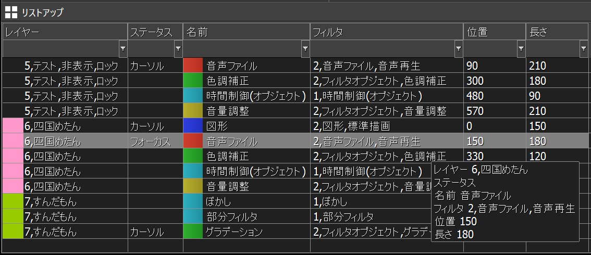
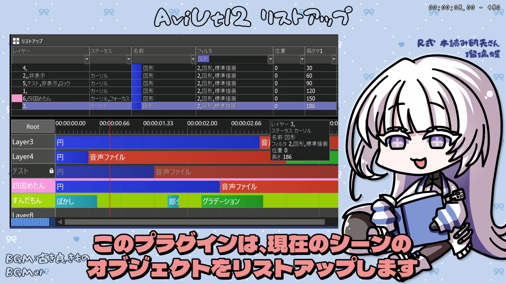

# 🐍AviUtl2 リストアップ

* aviutl2のタイムラインオブジェクトをリストアップします。

## 📺ニコニコ動画

* 親登録用のニコニコ動画です。
* 親登録は任意ですが、して頂けると作者の収入になるので、非常に助かります。
* ご負担でなければ、よろしくお願いします。
* [ニコニコの収入](https://x.com/search?q=%23%E3%83%8B%E3%82%B3%E3%83%8B%E3%82%B3%E3%81%AE%E5%8F%8E%E5%85%A5&f=live)はXでつぶやいていることがあります。

## 🚀インストール

* `プラグインフォルダ`に以下のファイルを入れてください。
	* `al2` ✏️フォルダ
		* `al2_timeline_object_lister.aux2` ✏️汎用プラグインファイル

## 🔥アンインストール

* `プラグインフォルダ`から以下のファイルを削除してください。
	* `al2` ✏️フォルダ
		* `al2_timeline_object_lister.aux2` ✏️このファイルを削除
		* `al2_timeline_object_lister` ✏️このフォルダを削除

## 💡使い方

1. aviutl2ウィンドウのメニューで`表示`➡`リストアップ`を選択します。
1. `リストアップ`ウィンドウが表示されます。
1. `タイムライン`に応じて表示が変わります。

### 🏷️設定を初期化する

1. aviutl2を起動していない状態で`プラグインフォルダ\al2\al2_timeline_object_lister\config`を削除してください。

## 🎨リストアップウィンドウ

* `並べ替え用ヘッダーコントロール` ✏️リストビューの上部にあります。
	* クリックするとその列を優先して`リスト`を並べ替えます。
	* 境界をドラッグすると、列幅を変更できます。
* `絞り込み用エディットボックス` ✏️ヘッダーコントロール下部にあるエディットボックスです。
	* 絞り込み用テキストを入力または選択します。
	* 入力した場合はEnterキーを押すと適用されます。
* `リスト` ✏️リストビューです。
	* 項目をクリックして選択すると、そのオブジェクトがフォーカスされます。
	* 項目をダブルクリックすると、そのオブジェクトが表示されるように、タイムラインがスクロールされます。
	* 右クリックすると`コンテキストメニュー`が表示されます。

## 🎨コンテキストメニュー

* `フレームを時間で表示` ✏️チェックを入れると、`位置`と`長さ`を時間で表示します。
* `リフレッシュ` ✏️現在のシーン内にある全てのオブジェクトをリストアップし、`リスト`を更新します。
* `並び順をリセット"` ✏️`リスト`の並べ替えをリセットします。
* `絞り込みをリセット"` ✏️`リスト`の絞り込みをリセットします。

## 🔖更新履歴

* 🔖r2 2026年11月17日
	* 🩹タイムラインをクリック(ドラッグ)したときリストアップに失敗する問題に対応
		* call_read_section()を使用するように変更
		* タイマー処理をメインウィンドウで行うように変更
* 🔖r1 2026年11月12日
	* 🎉初版
